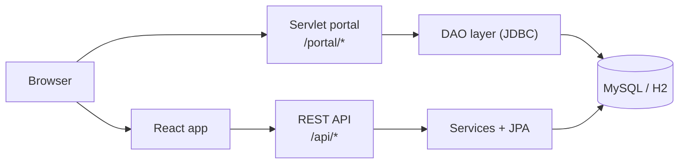

# Bharat National Bank — Online Banking System

A full-stack internet banking system written in Java. Customers can open accounts, transfer money, manage fixed deposits, loans, cards and bills; branch staff get an admin console to run the bank. The backend is Java 17 + Spring Boot with a real double-entry ledger, a servlet-based customer portal built on raw JDBC, and a React frontend.

> **For evaluators:** [RUBRIC.md](RUBRIC.md) maps every marking criterion (OOP, exceptions, collections, multithreading, JDBC, Servlets) to the exact classes that implement it.

## Contents

1. [Features](#features)
2. [Technology stack](#technology-stack)
3. [Requirements](#requirements)
4. [Project structure](#project-structure)
5. [Setup](#setup)
6. [Running the project](#running-the-project)
7. [Running the tests](#running-the-tests)
8. [Configuration](#configuration)
9. [Architecture](#architecture)
10. [Coding standards](#coding-standards)
11. [Troubleshooting](#troubleshooting)

## Features

**Customers**
- Sign up online with KYC (PAN, Aadhaar, date of birth), or log in with an email address or 11-digit Customer ID
- Dashboard with total balance, accounts, a 6-month money-in vs money-out chart, deposits, loans and today's transfer limit
- Savings, Current and Salary accounts with IFSC, UPI ID and nominee
- Fund transfers to own accounts, saved payees (IMPS, NEFT, RTGS) and UPI IDs, all authorised with a 6-digit transaction PIN
- Passbook with filters and search, and CSV statement download
- Fixed deposits with rate slabs, senior-citizen rates, maturity preview, premature closure and automatic renewal
- Loans (home, personal, car, education, gold) with an EMI calculator, online application, EMI repayment and prepayment
- Debit cards: block or unblock, report lost, channel switches and daily limits
- Bill payments and recharges, service requests and notifications

**Branch administrators**
- Overview with KPIs, a 14-day transaction volume chart and payment-channel breakdown
- Customer onboarding, suspension and unlocking; account freezing; branch cash deposits and withdrawals
- Bank-wide transaction ledger, loan approvals and the service-request queue
- Bank settings (transfer limits, interest rate, login attempts, maintenance mode) and monthly interest credit

**Servlet portal** (`/portal/*`)
- A customer portal built with plain `HttpServlet`s, a `Filter`, a listener and `HttpSession` login
- Accounts, mini statement, a 30-day report computed on worker threads, and an activity log written in JDBC batches

## Technology stack

| Layer | Technology |
|---|---|
| Language | Java 17 |
| Backend framework | Spring Boot 3.3 (embedded Tomcat), Spring MVC, Spring Security |
| Web | Jakarta Servlet API (`HttpServlet`, `Filter`, listeners) |
| Data access | JDBC (`PreparedStatement`, batches, transactions), Spring Data JPA / Hibernate |
| Database | MySQL 8 (default), H2 in-memory (demo profile) |
| Security | JWT (jjwt 0.12), BCrypt, role-based access |
| Frontend | React 19, TypeScript, Vite, Tailwind CSS 4, Recharts |
| Build & test | Maven (wrapper included), JUnit 5, AssertJ, Spring Boot Test |

## Requirements

| Software | Version | Needed for |
|---|---|---|
| JDK | 17 or newer (tested on 17 and 25) | Backend (required) |
| Node.js | 20 or newer (with npm) | React frontend (optional) |
| MySQL | 8.x | Only if you don't use the in-memory demo database |
| Git | any | Cloning the repository |

Maven does **not** need to be installed: the project includes the Maven wrapper (`mvnw` / `mvnw.cmd`). Check your Java version with `java -version`.

## Project structure

```
Banking_System/
├── README.md                 This file
├── RUBRIC.md                 Marking rubric → class mapping
├── schema.sql                Optional MySQL database creation script
├── backend/                  Java / Spring Boot application
│   ├── pom.xml               Maven build file (dependencies, Java version)
│   ├── mvnw, mvnw.cmd        Maven wrapper scripts
│   └── src/
│       ├── main/java/com/banking/
│       │   ├── BankingBackendApplication.java   Entry point
│       │   ├── core/          Plain-Java OOP model: BankAccount hierarchy, InterestBearing, Rankings
│       │   ├── jdbc/          DBConnection, DAO interfaces and their JDBC implementations
│       │   ├── web/           Servlet portal: servlets, auth filter, lifecycle listener, config
│       │   ├── controller/    REST controllers (/api/auth, /api/**, /api/admin/**)
│       │   ├── service/       Business logic: ledger, transfers, deposits, loans, reports, audit log
│       │   ├── model/         JPA entities (database tables)
│       │   ├── repository/    Spring Data JPA repositories
│       │   ├── dto/           Request and response records
│       │   ├── exception/     Custom checked exceptions and the global API error handler
│       │   ├── security/      JWT service and authentication filter
│       │   └── config/        Security configuration and demo-data seeder
│       ├── main/resources/
│       │   ├── application.properties      Default (MySQL) configuration
│       │   └── application-dev.properties  Demo profile (in-memory H2)
│       └── test/java/com/banking/          Unit and end-to-end tests
└── frontend/                 React + TypeScript single-page app
    ├── package.json
    ├── vite.config.ts        Dev server; proxies /api to the backend on port 8080
    └── src/
        ├── pages/            Customer pages; pages/admin/ for the admin console
        ├── components/       Shared UI components
        └── lib/              API client, types and formatting helpers
```

## Setup

### 1. Get the code

```bash
git clone <repository-url>
cd Banking_System
```

### 2. Choose a database

**Option A — no setup (recommended for a demo).** Run with the `dev` profile. It uses an in-memory H2 database and loads demo customers, accounts and six months of transactions on every start. Data is reset when the app stops.

**Option B — MySQL.** Install MySQL 8 and make sure it is running on `localhost:3306`. The app creates the `banking_db` database and all tables automatically on first start. Set your MySQL credentials if they are not `root` / `root`:

```bash
# macOS / Linux
export DB_USERNAME=your_user
export DB_PASSWORD=your_password
```

```powershell
# Windows PowerShell
$env:DB_USERNAME="your_user"
$env:DB_PASSWORD="your_password"
```

If your MySQL user is not allowed to create databases, run [schema.sql](schema.sql) once as an administrator first.

### 3. Install the frontend dependencies (optional)

Only needed if you want the React app:

```bash
cd frontend
npm install
```

## Running the project

### Backend (port 8080)

From the `backend` folder:

```bash
# Demo database (H2), macOS / Linux
./mvnw spring-boot:run -Dspring-boot.run.profiles=dev

# Demo database (H2), Windows
mvnw.cmd spring-boot:run -Dspring-boot.run.profiles=dev

# MySQL instead: leave out the profile
./mvnw spring-boot:run
```

The first run downloads dependencies and takes a minute or two. The backend is ready when the log shows `Started BankingBackendApplication`.

### Servlet portal

With the backend running, open **http://localhost:8080/portal/login**. No frontend is needed.

### React frontend (port 5173)

In a second terminal:

```bash
cd frontend
npm run dev
```

Open **http://localhost:5173**. The dev server forwards `/api` requests to the backend on port 8080.

### Demo accounts

These are created automatically on the first start.

| Role | Login | Password | Transaction PIN |
|---|---|---|---|
| Customer | `priya.v@example.com` | `Customer@123` | `123456` |
| Customer | `amit.p@example.com` | `Customer@123` | `123456` |
| Admin | `admin@bank.com` | `Admin@123` | — |

`rohan.m@example.com` is seeded as a locked account so you can try the admin unlock flow. The servlet portal is for customers only.

## Running the tests

From the `backend` folder:

```bash
./mvnw test        # Windows: mvnw.cmd test
```

| Test class | Type | What it checks |
|---|---|---|
| `BankAccountTest` | Unit | Polymorphic interest, custom exceptions, atomic transfers, and an 8-thread stress test (no lost money, no deadlock) |
| `ServletPortalIntegrationTest` | End-to-end | Starts the real server on H2 and checks the servlets, sessions, JDBC DAOs, batch audit log and threaded report |

All 12 tests pass.

## Configuration

Settings are read from environment variables, with defaults for local use:

| Variable | Default | Purpose |
|---|---|---|
| `DB_USERNAME` / `DB_PASSWORD` | `root` / `root` | MySQL credentials |
| `JWT_SECRET` | development-only value | Base64 HMAC key (256+ bits). **Always set this outside local development.** |
| `JWT_EXPIRATION_MINUTES` | `60` | How long a login lasts |
| `CORS_ORIGINS` | `http://localhost:5173` | Frontend origins allowed to call the API (comma-separated) |

Other settings, such as the server port, are in [application.properties](backend/src/main/resources/application.properties).

## Architecture



- **Two entry points, one database.** The servlet portal uses plain servlets and raw JDBC; the REST API serves the React app through Spring MVC and JPA.
- **One place changes balances.** Every debit and credit goes through `LedgerService`, which locks account rows in ascending id order so concurrent transfers can't overdraw an account or deadlock.
- **Customers see only their own data.** REST calls are scoped to the signed-in user, and the JDBC queries include the owner in the `WHERE` clause.

A fund transfer runs these steps in a single database transaction: authenticate → validate → verify PIN → check limits → lock rows → post debit and credit → notify. Any failure rolls the whole transfer back.

## Coding standards

- **Layered and modular.** Controllers and servlets only handle HTTP. Business rules live in services. SQL lives in DAOs and repositories. Each package has one responsibility (see [Project structure](#project-structure)).
- **Programming to interfaces.** DAOs are interfaces (`AccountDao`, `TransactionDao`, `AuditLogDao`) with JDBC implementations; the account model is an abstract class with polymorphic subclasses.
- **Constructor injection** for every service and component dependency.
- **Errors.** The core model and JDBC layer throw custom checked exceptions (`BankingException` and subclasses). The REST API throws `ApiException`, which `GlobalExceptionHandler` turns into consistent JSON errors.
- **Money as `BigDecimal`** with two decimal places for every balance and amount.
- **Resources closed with try-with-resources**; every SQL statement is a `PreparedStatement`.
- **Documented.** Every class has a Javadoc comment explaining its purpose, and public service methods describe what they do.
- **Naming.** Standard Java conventions: `PascalCase` classes, `camelCase` methods and fields, `UPPER_SNAKE_CASE` constants.

## Troubleshooting

| Problem | Fix |
|---|---|
| `Port 8080 was already in use` | Stop the other program on port 8080, or run with `-Dspring-boot.run.arguments=--server.port=8081` (the React proxy expects 8080). |
| `Access denied for user 'root'@'localhost'` | Set `DB_USERNAME` and `DB_PASSWORD`, or use the `dev` profile. |
| `Communications link failure` | MySQL isn't running. Start it, or use the `dev` profile. |
| `JAVA_HOME is not set` or `java` not found | Install a JDK (17 or newer) and set `JAVA_HOME` to its folder. |
| React app shows network errors | Make sure the backend is running on port 8080 before starting `npm run dev`. |
| Demo data looks different after a restart | Expected with the `dev` profile: the demo data is regenerated on every start. |
